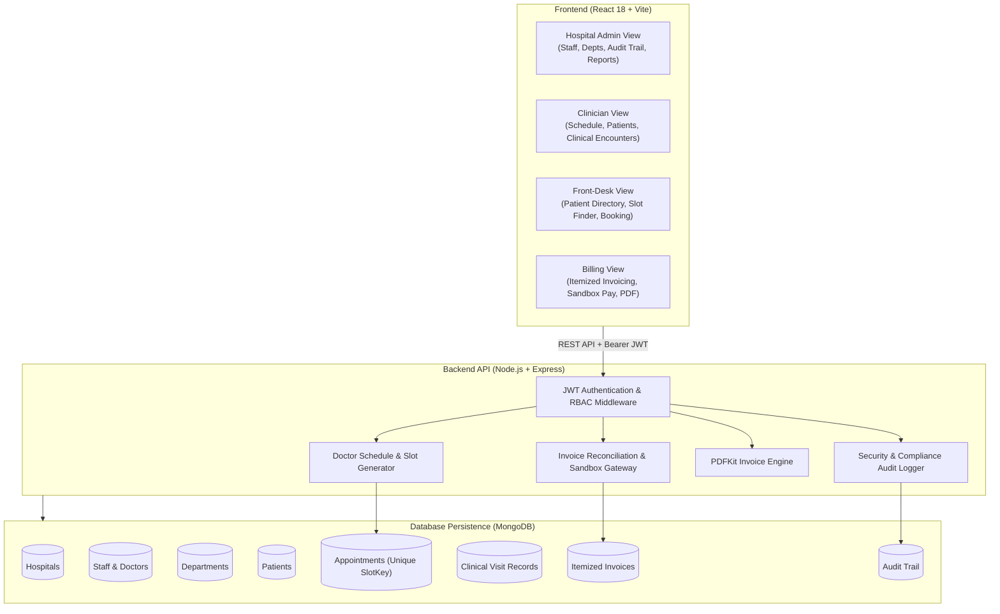
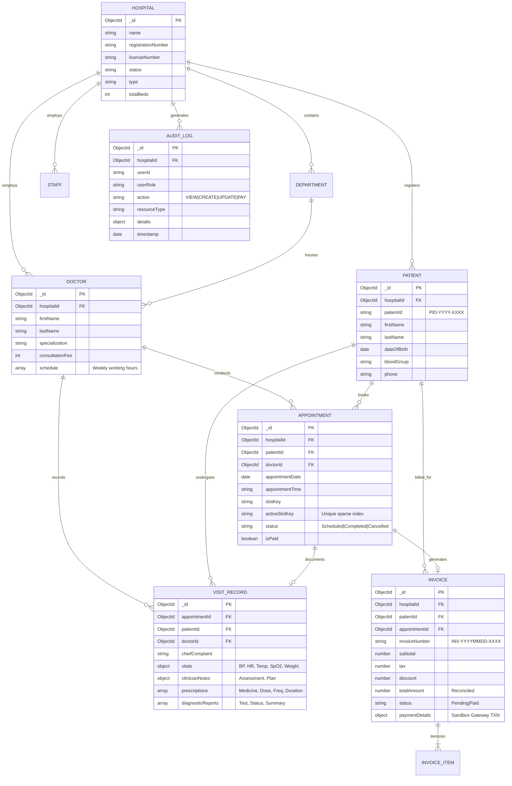

# 🏥 ZenoCare — Hospital Management System (HMS)

**Advanced Full-Stack Hospital Operations & Clinical Encounters Platform**  
*Built for Algions AI Labs Full-Stack Web Development Assessment*

---

## 🌟 Executive Summary

ZenoCare is a responsive, database-backed Hospital Management System engineered to support core operational hospital workflows, multi-role separation (Hospital Admin, Clinician, Receptionist/Front-Desk, and Billing), appointment scheduling with concurrency conflict protection, clinician-entered visit records, itemized billing with simulated sandbox payment reconciliation, and an immutable security audit trail.

---

## 📋 Acceptance Criteria & Verified Demonstrations

The system fulfills all 5 acceptance criteria defined in **03_Hospital_Management_System**:

| # | Acceptance Requirement | Implementation Mechanism | Test Status |
|---|---|---|:---:|
| **1** | **Patient Slot Booking** | Dynamic slot generation based on doctor weekly schedule minus booked slots. | ✅ Passed |
| **2** | **Conflict & Concurrency Prevention** | Atomic `activeSlotKey` with unique sparse indexing preventing race conditions and double bookings. | ✅ Passed |
| **3** | **Server-Side Role Separation (RBAC)** | Strict server-side middleware (`protect` & `allow`) blocking unauthorized record access. | ✅ Passed |
| **4** | **Invoice Reconciliation & Sandbox Payment** | Strict mathematical validation (`Σ(qty × price) + tax - discount = total`) and simulated sandbox payment gateway. | ✅ Passed |
| **5** | **Sensitive Record Audit Trail** | Automated audit logging capturing patient views, updates, clinical entries, and financial settlements. | ✅ Passed |

---

## 🏗️ System Architecture

ZenoCare follows a modular monolith architecture with clean separation of presentation, business logic, and database persistence.



---

## 🗄️ Entity-Relationship (ER) Diagram



---

## 🔑 Demo Credentials (Synthetic Evaluation Accounts)

All accounts are pre-seeded with synthetic test data:

| Role | Email | Password | Access Capabilities |
|---|---|---|---|
| **Super Admin** | `paras@gmail.com` (or `kenznajeeb@gmail.com`) | `admin123` | Platform-wide oversight, hospital approval & global analytics |
| **Hospital Admin** | `hospital@zenocare.com` | `hospital123` | Staff management, department setup, audit trail, reports |
| **Clinician (Doctor)** | `dr.sarah@zenocare.com` | `doctor123` | Appointment schedule, clinical encounter notes, vitals, prescriptions, diagnostic orders |
| **Front-Desk Reception** | `reception@zenocare.com` | `reception123` | Patient registration, live slot availability search, appointment booking & rescheduling |
| **Billing Executive** | `billing@zenocare.com` | `billing123` | Itemized invoice creation, sandbox payment verification, PDF receipt generation |

---

## ⚡ Quick Start & Local Setup

### Prerequisites
- **Node.js** (v18.0 or higher; tested on v24.3.0)
- **MongoDB** (Local instance on `mongodb://127.0.0.1:27017` or MongoDB Atlas URI)

### 1. Clone & Install
```bash
git clone https://github.com/KENZY004/ZenoCare.git
cd ZenoCare

# Install backend dependencies
cd backend
npm install

# Install frontend dependencies
cd ../frontend
npm install
```

### 2. Environment Configuration
The backend contains a `.env.example` file. Copy it to `.env`:
```bash
cd backend
cp .env.example .env
```
Default local settings in `.env`:
```env
PORT=5000
NODE_ENV=development
MONGODB_URI=mongodb://127.0.0.1:27017/zenocare
JWT_SECRET=JWT_SECRET_REDACTED
JWT_EXPIRE=7d
CLIENT_URL=http://localhost:5173
```

### 3. Seed Database with Synthetic Hospital Data
Populate the database with synthetic hospitals, doctors, patients, appointments, visit records, and audit logs:
```bash
cd backend
npm run seed
```

### 4. Run Automated Test Suite
Run the automated test suite demonstrating all 5 acceptance requirements and conflict handling:
```bash
cd backend
npm test
```
*Expected output: `✔ 5 passed, 0 failed`.*

### 5. Launch the Application
In separate terminal windows:
```bash
# Terminal 1: Backend API (Port 5000)
cd backend
npm run dev

# Terminal 2: Frontend Client (Port 5173)
cd frontend
npm run dev
```
Open your browser at: **`http://localhost:5173`**

---

## 🧪 Acceptance Test Evidence

The automated test suite (`backend/tests/acceptance.test.js`) verifies all critical business rules:
- **Test 1**: Searches available doctor slots based on working schedule and books into a verified slot.
- **Test 2**: Conflicting appointments for the same doctor/time are prevented sequentially and concurrently (returns `409 Conflict`).
- **Test 3**: Role-Based Access Control: Unauthorized roles are denied access (`403 Forbidden`) when attempting to create clinical visit records or remove staff.
- **Test 4**: An invoice strictly reconciles with line items (`Σ(qty × price) + tax - discount`), and sandbox payment verifies amount and sets transaction status to `Paid`.
- **Test 5**: Reading or editing sensitive patient records generates a permanent audit trail entry in the database.

---

## 🛡️ Security & Engineering Decisions

1. **Server-Side Authorization**: Roles are validated in backend middleware (`allow('doctor')`, `allow('hospital_admin')`), ensuring that hiding UI elements is never relied upon as a security boundary.
2. **Race Condition Prevention**: Concurrency conflicts are prevented at the database persistence tier using a sparse compound unique constraint on active bookings (`activeSlotKey`).
3. **No Automated Diagnosis**: Clinician notes are strictly structured into standard subjective/objective/assessment/plan fields entered solely by verified medical professionals.
4. **Itemized Billing Reconciliation**: Server rejects mismatched invoice calculations or unauthorized payment amounts with `422 Unprocessable Entity`.
5. **Simulated Payment Sandbox**: Mimics real-world payment gateway transactions with reference IDs, idempotency checks, and PDF receipt downloads.

---

## ⚠️ Known Limitations & Assumptions

- **External Payment Gateways**: Live payment processing (e.g., Stripe/Razorpay) is intentionally mocked via the simulated sandbox payment flow per assessment instructions.
- **Email Service**: Nodemailer uses a dummy SMTP configuration in local environments; production deployment requires valid SMTP or SendGrid API credentials.
- **Synthetic Data**: All patient names, phone numbers, vitals, and diagnostic results are generated synthetically for testing and compliance.

---

## 📄 License & Ownership

Developed by Kenz Najeeb as part of the Algions AI Labs Full-Stack Web Development Advanced Assessment.
