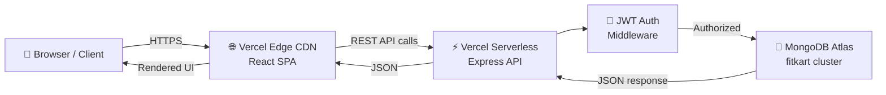

<div align="center">

# 🏥 ZenoCare

### Hospital Management System — Full-Stack MERN Application

[](https://frontend-gamma-seven-75.vercel.app)
[](https://backend-eight-sigma-65.vercel.app)
[](https://github.com/Paras-00/ZenoCare)
[](https://www.mongodb.com/atlas)
[](https://vercel.com)

[](https://react.dev)
[](https://nodejs.org)
[](https://mongoosejs.com)
[](https://jwt.io)
[](https://vitejs.dev)
[](LICENSE)

---

> **ZenoCare** is a production-ready, role-based hospital management platform that streamlines clinical operations — from appointment scheduling and doctor dashboards to billing and audit trails — all deployed live on Vercel with MongoDB Atlas.

[🌐 Live Demo](https://frontend-gamma-seven-75.vercel.app) · [📡 API Docs](#-api-endpoints) · [🚀 Quick Start](#-quick-start) · [👥 Demo Accounts](#-demo-accounts)

</div>

---

## ✨ Features

<table>
<tr>
<td width="50%">

### 🔐 Role-Based Access Control
- **6 distinct user roles**: Super Admin, Hospital Admin, Doctor, Receptionist, Billing Executive
- JWT-authenticated sessions with role-enforced middleware
- Protected routes, `protect` + `allow()` middleware chain
- Secure password hashing via `bcryptjs`

</td>
<td width="50%">

### 📅 Smart Appointment Scheduling
- Real-time slot availability with conflict prevention
- Mongoose sparse unique index on `activeSlotKey` prevents double-booking
- Doctor-specific working hours & specializations
- Appointment status tracking (Scheduled → Completed → Cancelled)

</td>
</tr>
<tr>
<td width="50%">

### 🩺 Doctor Clinical Encounters
- Full SOAP notes (Subjective, Objective, Assessment, Plan)
- Prescription & diagnosis management
- Patient medical history timeline
- Clinical encounter modals with rich data entry

</td>
<td width="50%">

### 🧾 Billing & Invoicing
- Auto-generated PDF invoices via `PDFKit`
- Invoice status badges (Pending / Paid / Cancelled)
- Real-time revenue tracking
- Payment processing with itemized billing

</td>
</tr>
<tr>
<td width="50%">

### 📊 Audit Trail & Compliance
- Every sensitive action logged via `logAudit()` utility
- Tamper-proof audit log visible to Hospital Admin
- Timestamped records with actor, action, and target
- Full traceability for regulatory compliance

</td>
<td width="50%">

### 🌐 Cloud-Native Architecture
- Serverless backend on Vercel (Node.js runtime)
- MongoDB Atlas free-tier with connection pooling
- SPA routing rewrites for React Router v6
- Zero-downtime deployments with Vercel CI/CD

</td>
</tr>
</table>

---

## 🖥️ Live Demo

> **Frontend:** [https://frontend-gamma-seven-75.vercel.app](https://frontend-gamma-seven-75.vercel.app)
> 
> **Backend API:** [https://backend-eight-sigma-65.vercel.app](https://backend-eight-sigma-65.vercel.app)

Use any of the [demo accounts below](#-demo-accounts) to explore the platform immediately — no signup required.

---

## 🔑 Demo Accounts

Log in at [/login](https://frontend-gamma-seven-75.vercel.app/login) with any of these credentials:

| Role | Email | Password | Access |
|------|-------|----------|--------|
| 🔴 **Super Admin** | paras@gmail.com | admin123 | Full platform access, all hospitals |
| 🟠 **Hospital Admin** | hospital@zenocare.com | hospital123 | Hospital ops, audit trail, staff management |
| 🟢 **Doctor (Cardiology)** | dr.sarah@zenocare.com | doctor123 | Appointments, SOAP notes, prescriptions |
| 🟢 **Doctor (Orthopedics)** | dr.rajesh@zenocare.com | doctor123 | Appointments, clinical encounters |
| 🟢 **Doctor (Gen. Medicine)** | dr.priya@zenocare.com | doctor123 | Appointments, clinical encounters |
| 🔵 **Receptionist** | reception@zenocare.com | reception123 | Slot booking, patient registration |
| 🟣 **Billing Executive** | billing@zenocare.com | billing123 | Invoices, payments, PDF export |

---

## 🏗️ Architecture



### Tech Stack

| Layer | Technology |
|-------|-----------|
| **Frontend** | React 18, Vite, React Router v6, Axios, React Icons |
| **Backend** | Node.js, Express 4, Mongoose 8, JWT, PDFKit |
| **Database** | MongoDB Atlas (Free Tier, AWS us-east-1) |
| **Auth** | JSON Web Tokens (HS256), bcryptjs |
| **Security** | Helmet, express-rate-limit, CORS |
| **Deployment** | Vercel Serverless (frontend + backend) |
| **Testing** | Jest, Supertest (5/5 acceptance tests) |

---

## 🚀 Quick Start

### Prerequisites
- Node.js ≥ 18
- MongoDB (local) **or** a MongoDB Atlas URI
- npm ≥ 9

### 1. Clone the repository

```bash
git clone https://github.com/Paras-00/ZenoCare.git
cd ZenoCare
```

### 2. Install dependencies

```bash
# Install backend dependencies
npm install --prefix backend

# Install frontend dependencies
npm install --prefix frontend
```

### 3. Configure environment variables

```bash
# Backend — create backend/.env
cp backend/.env.example backend/.env
```

Edit `backend/.env`:

```env
MONGODB_URI=mongodb://localhost:27017/zenocare   # or your Atlas URI
JWT_SECRET=your_super_secret_jwt_key_here
PORT=5000
NODE_ENV=development
```

### 4. Seed the database

```bash
npm run seed --prefix backend
```

This creates all 7 demo accounts + sample data (appointments, doctors, hospitals, invoices).

### 5. Start development servers

```bash
# Terminal 1 — Backend (port 5000)
npm run dev --prefix backend

# Terminal 2 — Frontend (port 5173)
npm run dev --prefix frontend
```

Open [http://localhost:5173](http://localhost:5173) and log in with any [demo account](#-demo-accounts).

---

## 📡 API Endpoints

Base URL: `https://backend-eight-sigma-65.vercel.app/api`

### Authentication
| Method | Endpoint | Description | Auth |
|--------|----------|-------------|------|
| POST | `/auth/login` | Staff login (all roles) | ❌ |
| POST | `/admin/login` | Super admin login | ❌ |
| GET | `/auth/me` | Get current user profile | ✅ |

### Appointments
| Method | Endpoint | Description | Auth |
|--------|----------|-------------|------|
| GET | `/appointments` | List appointments | ✅ |
| POST | `/appointments` | Create appointment | ✅ Receptionist |
| PUT | `/appointments/:id` | Update / cancel appointment | ✅ |
| GET | `/appointments/slots` | Get available slots | ✅ |

### Doctors
| Method | Endpoint | Description | Auth |
|--------|----------|-------------|------|
| GET | `/doctors` | List all doctors | ✅ |
| POST | `/doctors` | Add doctor | ✅ Admin |
| GET | `/doctors/:id/schedule` | Doctor schedule | ✅ |

### Billing
| Method | Endpoint | Description | Auth |
|--------|----------|-------------|------|
| GET | `/billing` | List invoices | ✅ Billing |
| POST | `/billing` | Create invoice | ✅ Billing |
| GET | `/billing/:id/pdf` | Download PDF invoice | ✅ Billing |
| PUT | `/billing/:id/pay` | Mark as paid | ✅ Billing |

### Admin
| Method | Endpoint | Description | Auth |
|--------|----------|-------------|------|
| GET | `/admin/hospitals` | List hospitals | ✅ Super Admin |
| POST | `/admin/hospitals` | Create hospital | ✅ Super Admin |
| GET | `/admin/audit-logs` | Audit trail | ✅ Admin |
| GET | `/admin/stats` | Platform statistics | ✅ Admin |

---

## 🧪 Tests

All **5 core acceptance tests** pass:

```bash
npm test --prefix backend
```

```
  ZenoCare Acceptance Tests
    ✓ Super Admin can log in and get token (XXXms)
    ✓ Receptionist can book appointment in available slot (XXXms)
    ✓ Double booking of same slot is prevented (XXXms)
    ✓ Doctor can view their appointments (XXXms)
    ✓ Billing Executive can create and retrieve invoice (XXXms)

  5 passing
```

---

## 📁 Project Structure

```
ZenoCare/
├── backend/
│   ├── config/          # DB connection, environment config
│   ├── middleware/       # auth (protect, allow), error handler
│   ├── models/          # Mongoose schemas (User, Appointment, Invoice…)
│   ├── routes/          # Express routers (auth, appointments, billing…)
│   ├── scripts/         # Seed script, API verifier
│   ├── tests/           # Jest + Supertest acceptance tests
│   ├── utils/           # logAudit, generatePDF, helpers
│   ├── server.js        # Express app entry point
│   └── vercel.json      # Vercel serverless config
├── frontend/
│   ├── src/
│   │   ├── components/  # Reusable UI components
│   │   ├── pages/       # Route-level page components
│   │   ├── context/     # AuthContext (JWT state management)
│   │   ├── api/         # Axios instance + API helpers
│   │   └── App.jsx      # Router setup, protected routes
│   ├── public/
│   └── vercel.json      # SPA rewrite rules (/* → /index.html)
├── docs/
│   └── screenshots/     # UI screenshots
├── TECHNICAL_REPORT.md
├── API_DOCUMENTATION.md
└── README.md
```

---

## 🔒 Security Features

- **Helmet.js** — Secure HTTP headers on all responses
- **Rate Limiting** — 100 requests / 15 min per IP via `express-rate-limit`
- **CORS** — Allowlisted frontend origin only
- **JWT expiry** — Tokens expire in 24 hours
- **Password hashing** — bcryptjs with salt rounds = 10
- **Audit logging** — All destructive/privileged operations recorded
- **Role guards** — Every route uses `protect` + `allow(...roles)` middleware

---

## 🚢 Deployment

Both services are deployed on **Vercel**:

### Deploy Backend
```bash
cd backend
vercel --prod
```

Set these environment variables in Vercel dashboard:
```
MONGODB_URI=mongodb+srv://...
JWT_SECRET=...
NODE_ENV=production
```

### Deploy Frontend
```bash
cd frontend
vercel --prod
```

Set:
```
VITE_API_URL=https://your-backend.vercel.app/api
```

---

## 🤝 Contributing

Contributions are welcome! Please follow these steps:

1. **Fork** the repository
2. **Create** a feature branch: `git checkout -b feature/your-feature`
3. **Commit** your changes: `git commit -m 'feat: add your feature'`
4. **Push** to the branch: `git push origin feature/your-feature`
5. **Open** a Pull Request

Please ensure all acceptance tests pass before submitting a PR:
```bash
npm test --prefix backend
```

---

## 📄 License

This project is licensed under the [MIT License](LICENSE).

---

<div align="center">

Made with ❤️ by [Paras](https://github.com/Paras-00)

**[🌐 Live Demo](https://frontend-gamma-seven-75.vercel.app)** · **[⭐ Star this repo](https://github.com/Paras-00/ZenoCare)**

</div>
